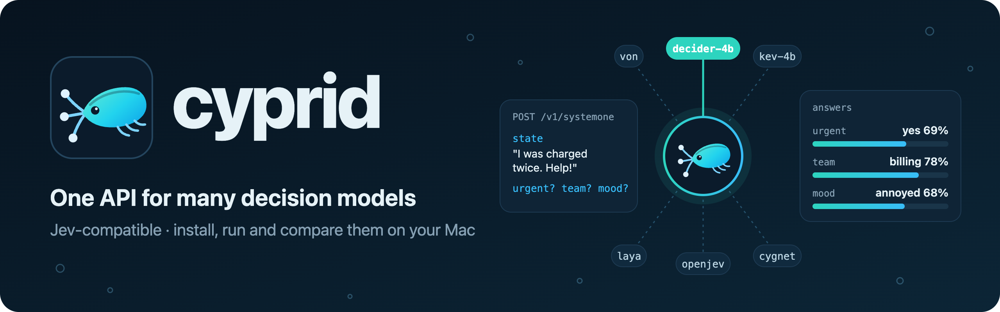

# cyprid

cyprid runs **decision models** on your Mac and gives them all one simple way to
be asked questions.

A decision model doesn't write text. You give it a piece of text (an email, a
support ticket, a policy) and questions with fixed possible answers, and it tells
you how likely each answer is:

- **yes/no**: "Is this urgent?" → 69% yes
- **pick one**: "Which team should handle this: billing, technical or sales?" → billing 78%
- **rate it**: "How frustrated is the customer: calm, annoyed or very angry?" → mostly annoyed

Your own code can then act on the answer ("if urgent is over 90%, page someone").
TypeSafe's hosted **Jev** made this style of model popular; there are now many
open alternatives that run on your own machine. cyprid installs them, starts and
stops them, and puts them all behind the same API and a web page, so you can
compare them and switch between them without changing your code.

You don't need to know Python or Go. cyprid sets up everything each model needs,
and the steps below cover the rest. Everything runs on your own Mac: nothing you
ask a local model leaves your computer.

*cyprid is an independent open-source project by Barnacle Labs. It isn't affiliated
with or endorsed by TypeSafe AI, whose product Jev is; "Jev-compatible" means only
that cyprid accepts the same kind of requests. Nor is it affiliated with the authors
of the models it can run.*

---

## What you need

- **A Mac with Apple Silicon** (M1, M2, M3, M4 or M5). To check: Apple menu →
  **About This Mac** → the **Chip** line should say "Apple M…". Intel Macs aren't supported.
- **Memory**: 16GB is enough for the small models; 32GB or more for the larger
  ones. The **Choosing a model** section lists what each needs.
- **Disk space**: from 3GB to about 25GB per model you install.
- **An internet connection** while installing (keep the Mac awake and the lid open
  while things download). After that, local models work offline.
- **About 15 minutes** for the one-time setup.

---

## One-time setup

You'll type a few commands into **Terminal**, the Mac's command window. Open it
with **⌘ Space**, type `Terminal` and press **Return**. For each command below,
copy it, paste it into Terminal and press **Return**, then wait for it to finish
(you'll see the prompt, ending in `%`, again).

### 1. Install Homebrew

Homebrew installs developer tools on a Mac. You may already have it; check with:

```sh
brew --version
```

If that prints a version number, go to step 2. If it says `command not found: brew`,
install it:

```sh
/bin/bash -c "$(curl -fsSL https://raw.githubusercontent.com/Homebrew/install/HEAD/install.sh)"
```

It asks for your Mac password (nothing appears as you type; that's normal) and
then stops at **"Press RETURN to continue"**: press Return. It may also install
Apple's developer tools first, which can take 5–15 minutes.

**When it finishes, look near the end for "Next steps".** Under it are two or three
lines starting with `echo` and `eval`. Copy each one, paste it into Terminal and
press Return. Then close Terminal, open a new window, and check it worked:

```sh
brew --version
```

This should now print a version, such as `Homebrew 7.0.6`.

### 2. Install Go and uv

```sh
brew install go uv
```

- **Go** is the language cyprid is written in. You need it only to build
  cyprid in the next steps.
- **uv** downloads the right version of Python for each model and keeps each
  model's software separate. cyprid uses it for you; you'll never run it yourself.

It prints a lot of text. It worked if the last lines don't mention `Error`.

### 3. Get the cyprid folder and go into it

You need a copy of the **cyprid** folder: the one containing this README file. If
you were given it as a `.zip` file, double-click it to unzip it, and move the folder
somewhere easy to find, such as your **Documents** folder. (The folder might be
called `cyprid` or something like `cyprid-main`; the name doesn't matter.)

Then tell Terminal to work inside it: type `cd` followed by a space, **drag the
folder from Finder into the Terminal window** (this types its location for you),
and press **Return**.

### 4. Build and install cyprid

```sh
./install.sh
```

This builds cyprid (about half a minute the first time; it may print a
`go: downloading …` line) and copies it to Homebrew's folder of programs, so you
can type `cyprid` in any Terminal window. It worked if the last line starts with
`cyprid dev` or `cyprid v`, which is the version you now have.

**Updating later:** after getting a new version of the cyprid folder, repeat
steps 3 and 4. The copy `./install.sh` makes doesn't update itself, so skipping
step 4 leaves you running the old version (`cyprid version` shows which one you
have).

---

## First run

### 1. Start the server

```sh
cyprid serve
```

The **server** is the part of cyprid that keeps running and answers questions.
You'll see a line containing `cyprid … listening on http://127.0.0.1:8765` and a
list of models, and **your browser opens the cyprid web page by itself**, already
signed in. (`127.0.0.1` is an address that means "this Mac", and `8765` is the
channel cyprid listens on.) **Leave this Terminal window open**: the server runs as
long as it's open. To stop it, click in the window and press **Control-C**, which
also stops any models it started.

For other commands, open a second Terminal window with **⌘ N**.

### 2. The web page

The **Models** tab lists every model cyprid knows about. If you close the page, run
`cyprid ui` to open it again. Your browser stays signed in for 30 days, so you can
also bookmark **http://127.0.0.1:8765**.

The page only opens for you: it can install and run software on this Mac, so it
needs a secret that only your Mac account can read. If you ever see **Sign in to
cyprid**, run `cyprid ui`.

### 3. Install your first model

Click **Install** next to **von**. It's small (about 3GB) and fast, which makes it
a good first model. The window at the bottom shows progress: the first install
downloads the model's software and its **weights** (the model's learned data, the
big part of the download, fetched from the Hugging Face model site). It takes a few
minutes. When it's done, the last line starts with `==> von installed` and von's
**Installed** column turns green. Nothing is downloaded again later.

Or, in the second Terminal window:

```sh
cyprid install von
```

### 4. Ask it something

Open the **Playground** tab. An example is already filled in. Click **von** in the
list of models at the top so it's highlighted in blue, then click **Send**. You'll see its
answers to three example questions as bars. The first question to a model takes a
few seconds while it loads; after that it answers almost instantly.

Then try your own: put the text you want a decision about in the **State** box, and
edit the questions below it. You can also highlight several installed models to
compare their answers side by side.

---

## Asking questions from your own code

*Optional: only needed if you want programs to use cyprid. Everything above works
from the web page.*

Programs ask cyprid questions through its **API**, a way for programs to send it
requests over the web, the way a browser does, but to this Mac only. You can try it
from Terminal with `curl`, a command built into every Mac that sends web requests.
This sends one piece of text and three questions to von:

```sh
curl http://127.0.0.1:8765/v1/systemone -d '{
  "model": "von",
  "state": "Help! My payouts have been failing for 3 days and I was charged twice.",
  "questions": {
    "is_urgent":  {"type": "noul",   "instructions": "Does this convey urgency?"},
    "department": {"type": "choice", "instructions": "Which team should handle this?",
                   "criteria": {"billing": "Payments, refunds", "technical": "Bugs, outages", "sales": "Pricing"}},
    "frustration": {"type": "score", "instructions": "How frustrated is the customer?",
                    "criteria": ["Calm", "Annoyed", "Very angry"]}
  }
}'
```

- **`model`**: which model to ask (see **Choosing a model**).
- **`state`**: the text to decide about.
- **`questions`**: as many as you like, each with a name you choose:
  - `noul`: a yes/no question (`noul` is this format's name for yes/no).
  - `choice`: pick one option from `criteria` (option name → description).
  - `score`: pick a level from `criteria`, a list ordered from lowest to highest.

The answer appears right below the command, all on one line. Here it is spaced
out to make it easier to read (a real answer from von):

```json
{
  "answers": {
    "is_urgent":  {"type": "noul", "noul": 0.6922},
    "department": {"type": "choice", "choice": "billing",
                   "probabilities": {"billing": 0.7825, "technical": 0.1491, "sales": 0.0684},
                   "confidence": 0.674},
    "frustration": {"type": "score", "score": 1.25,
                    "probabilities": {"0": 0.0328, "1": 0.6813, "2": 0.2858},
                    "legend": {"0": "Calm", "1": "Annoyed", "2": "Very angry"},
                    "confidence": 0.522}
  },
  "model": "von",
  "usage": {"input_tokens": 38, "output_tokens": 3}
}
```

- **`noul`** is the probability the answer is yes (0.69 = 69%).
- **`choice`** is the most likely option, and **`probabilities`** gives every option's share.
- **`score`** is the average level, counting from 0 = Calm: 1.25 means a little above "Annoyed".
- **`confidence`** is how settled the model is, from 0 to 1.

This is the same format as TypeSafe's Jev, so, for programmers, **TypeSafe's own
libraries work with cyprid unchanged**: set their base URL to `http://127.0.0.1:8765`.

**Models start by themselves.** Any installed model starts on its first request
and stops after 30 minutes without requests, freeing its memory. A model that
isn't installed gets an error telling you how to install it; cyprid never
downloads anything without you asking.

**Using TypeSafe's hosted Jev** (the `jev` model) needs a TypeSafe API key. Stop
the server (Control-C in its window), then in that same window run:

```sh
export TYPESAFE_API_KEY=your-key-here
cyprid serve
```

---

## Choosing a model

**Not sure? Start with von. If your Mac has 16GB of memory or more, try decider-4b
next: it's the best all-rounder here.**

Accuracy is the share of questions answered correctly on two public test sets, the
Kev suite and JevBench (higher is better). It doesn't depend on which Mac you use,
apart from tiny rounding differences. Speed does depend on your Mac, so it isn't
listed: `cyprid bench` measures it on yours (see **Benchmarking**). "Built on" says
which company's model each one started from, for anyone who cares where their
models come from.

| Model | Good for | Download | Memory when running | Built on | Accuracy (Kev suite / JevBench) |
|---|---|---|---|---|---|
| **von** | first model; fast, simple labelling | 3.2GB | ~3GB | ModernBERT (Answer.AI & LightOn, US/France) | 72% / 59% |
| **decider-4b** | best all-rounder here | 8.4GB | ~11GB | Qwen3.5 (Alibaba, China) | 82% / 83% |
| **openjev** | most accurate here | 16.6GB | ~18GB | DiffusionGemma (Google, US) | 83% / 83% |
| **clef-flash** | most accurate on the Kev suite; needs memory | 19.1GB | ~22GB | Qwen3.5 (Alibaba, China) | 84% / 82% |
| **kev-4b** | accurate, and its confidence is trustworthy | 9.5GB | ~12GB | Qwen3.5 (Alibaba, China) | 81% / 76% |
| decider-2b | lighter decider | 3.8GB | ~6GB | Qwen3.5 (Alibaba, China) | 73% / 76% |
| kev-0.8b | smallest Kev | 1.8GB | ~4GB | Qwen3.5 (Alibaba, China) | 65% / 64% |
| laya | very fast, short texts only | 2.4GB | ~4GB | ModernBERT / mmBERT (US/France) | 65% / 58% |
| cygnet-8bit | Google's Gemma, carefully read | 12.7GB | ~15GB | Gemma 4 (Google, US) | not measured here |
| jevmlx-qwen2.5-7b | any MLX model as a decision model | 4.3GB | ~7GB | Qwen2.5 (Alibaba, China) | 55% / 65% |
| gliner2.5-decide | simple labelling only | 2.0GB | ~2GB | DeBERTa-v3 (Microsoft, US) | 54% / 54% |
| jev | TypeSafe's hosted original | — | — | undisclosed (TypeSafe, US) | 86% / 87% (published) |

Also available: `kev-9b`, `kev-27b`, `decider-0.8b`, `jevmlx-qwen2.5-3b`,
`cygnet` in full precision (24GB; too slow on a 36GB Mac), and `clef`, Cloudflare's
27B Clef (55GB; needs a Mac with 96GB of memory or more).

Things worth knowing:

- **Some models only read short texts.** Laya reads the first 512 *tokens* (the
  word-pieces models read; roughly 400 words), and GLiNER was trained on the same length. For long documents, use
  openjev, decider or kev. The **Context** column in the web page shows each model's limit.
- **clef-flash only just fits a 36GB Mac.** It runs in full precision (about 22GB
  when running), so close other big apps first. On long documents the Mac's GPU
  memory can fill up; when it does, that one request gets an error and the model
  restarts itself (about a minute), so try again. With 48GB or more it's comfortable.
- **openjev is over-confident**: when it's wrong it is often still "99% sure". If
  your code acts on confidence, see **Calibration** below.
- **Memory:** models that don't fit alongside the others are stopped to make room.
  If your Mac slows down, check **Activity Monitor → Memory** and prefer smaller models.
- **The web page shows each model's sources, licence, installed version and what it's built on.**

---

## Everyday commands

Apart from `cyprid serve` itself, run these in a second Terminal window while the
server is running.

| Command | What it does |
|---|---|
| `cyprid serve` | start the server and open the web page (leave its window open; Control-C stops it) |
| `cyprid ui` | open the web page, signed in |
| `cyprid list` | every model: installed or not, running or not |
| `cyprid info von` | everything about one model: version, sources, context, memory |
| `cyprid install von` | download and set up a model |
| `cyprid uninstall von` | remove a model's software, but keep its downloaded weights (so the disk space isn't freed) |
| `cyprid uninstall --delete-weights von` | remove it completely and free the disk space |
| `cyprid ps` | which models are running now |
| `cyprid start von` / `cyprid stop von` | load a model ahead of time / unload it |
| `cyprid logs von` | a model's log, useful when something goes wrong |
| `cyprid bench --models von,decider-4b` | score models on a benchmark (takes minutes) |
| `cyprid open bench` | show benchmark results in Finder (also `logs`, `recipes`, `weights`, `config`, or nothing for all of cyprid's data) |
| `cyprid version` | which version of cyprid you're running |
| `cyprid help` | the full list |

Everything here can also be done from the web page.

---

## Recipes: how cyprid knows how to run each model

Every model needs different things to run: a particular version of Python, its own
software packages, its weights downloaded, and its own command to start it. Working
all that out is the hard part of using these models, and it's what cyprid saves you
from. It keeps that knowledge in a **recipe** for each model: a short text file
saying how to install it, how to start it, how to tell when it's ready, and facts
about it (licence, memory, what it's built on).

**Most people never need to touch a recipe.** cyprid comes with recipes for every
model in **Choosing a model**, and `cyprid install` uses them for you.

You'd look at one when you want to:

- **add a model cyprid doesn't list**, for example another MLX chat model for jevmlx,
  or a Jev-compatible server that's already running somewhere else;
- **change how a model runs**, for example giving OpenJev more context, or pinning
  a model to exact weights;
- **see exactly what cyprid does** when it installs and starts a model.

The easiest place is the web page's **Recipes** tab: pick a recipe, edit it and click
**Save**. cyprid checks it before saving, and **Reset to built-in** undoes your
changes. From Terminal: `cyprid recipe show laya` prints one, and
`cyprid recipe edit laya` opens it for editing. The **Recipe reference** section below
explains every line, with worked examples.

---

## When something goes wrong

| You see | What to do |
|---|---|
| `command not found: brew` | Homebrew isn't finished: run the "Next steps" commands it printed, then open a new Terminal window. |
| `command not found: cyprid` | Do step 4 of setup (`./install.sh`), then open a new Terminal window. |
| `error: unknown command "…"` for a command in this README | You're running an old copy: redo step 4 of setup (`./install.sh`). |
| The web page says **Sign in to cyprid** | Run `cyprid ui`, which opens it signed in. |
| `command not found: go` | Run `brew install go uv`, then open a new Terminal window. |
| `error: server not reachable at http://127.0.0.1:8765 (start it with: cyprid serve)` | The server isn't running. Start it in another window with `cyprid serve`. |
| `error: listen tcp 127.0.0.1:8765: bind: address already in use` | cyprid is already running, probably in another Terminal window. Use that one. |
| `model von is not installed; run: cyprid install von` | Install it first, or pick an installed model. |
| `model … is loading; retry shortly` | The model is starting up (big ones take up to a minute). Try again in a few seconds. |
| `… needs ~18GB but only …GB of the …GB budget is free` | Not enough memory while other models are busy. Stop one (`cyprid stop …`) or use a smaller model. |
| `jev needs an API key` | Set `TYPESAFE_API_KEY` before `cyprid serve` (see above). |
| `uv not found on PATH` | Run `brew install uv`, then restart the server. |
| A model says "failed" | Look at its log: the **Logs** button in the web page, or `cyprid logs <model>`. |
| A red banner says a recipe has an error | A recipe you edited isn't valid. cyprid keeps using the previous version until you fix it or click **Reset to built-in** in the Recipes tab. |
| A model shows **outdated** | Its recipe's install section changed. Run `cyprid install <model>` again. |
| Everything is very slow | The Mac is probably out of memory. Close other apps, stop large models, or use smaller ones. |

---

## Removing things

- **One model**: in the web page, click **Uninstall** and tick **Also delete
  downloaded weights**. Or run `cyprid uninstall --delete-weights <model>`.
- **cyprid entirely**:
  1. Uninstall each model with its weights, as above. (Weights are in the shared
     Hugging Face folder, `~/.cache/huggingface`, which other apps may also use,
     so don't delete that folder by hand.)
  2. Stop the server (Control-C), then run:
     ```sh
     rm -rf ~/.cyprid
     ```
     and:
     ```sh
     rm /opt/homebrew/bin/cyprid
     ```
  3. Delete the cyprid folder.
  4. Optionally remove the tools: `brew uninstall go uv`.

---

## Licence

cyprid is open source under the [Apache License 2.0](LICENSE). Copyright 2026 Barnacle
Labs; see [NOTICE](NOTICE).

cyprid isn't affiliated with or endorsed by TypeSafe AI or the authors of any model
it runs. Jev and the other model names belong to their owners and are used only to
say which models cyprid works with.

The models cyprid installs are not part of cyprid. Each is downloaded from its own
source under its own licence, which the web page and `cyprid info <model>` show.
Most are Apache-2.0 or MIT, but check before relying on one commercially. For
example, Cygnet's Gemma 4 weights are Apache-2.0 but also subject to Google's Gemma
Prohibited Use Policy, Llama models (if you add them) have Meta's own licence, and
hosted Jev is TypeSafe's service with its own terms.

---

# Reference

The rest is for readers who want the details.

## Web page and security

The web page at http://127.0.0.1:8765 has four tabs. **Models** covers
installing, starting, stopping, logs, calibration and uninstalling. **Playground**
asks several models the same question. **Recipes** lets you view and edit how each
model is installed and started; saves are checked, and you can reset to the
built-in version. **Benchmarks** browses benchmark results.

Recipes decide which programs cyprid runs, so the web page and the management API
(`/admin`) are protected in layers:

- they only accept requests from this Mac, addressed to it, and from the page itself,
  so other machines, other websites (CSRF) and DNS-rebinding tricks can't use them,
  even with network access on;
- they need cyprid's **access token**, a random secret in `~/.cyprid/admin-token` that
  only your Mac account can read, so other accounts on a shared Mac can't use them either.

The `cyprid` command sends the token by itself. Browsers sign in with a **one-time
link**: `cyprid serve` prints one and opens another, and `cyprid ui` makes a new one.
Each works once, within a few minutes, and swaps itself for a cookie that page scripts
can't read and other sites never send, so the secret never appears in an address or
your browser history. To sign every browser out, delete `~/.cyprid/admin-token` and
restart the server. The question API (`/v1/…`) stays open to programs on this Mac, as
Ollama's does. To report a security problem, see [SECURITY.md](SECURITY.md).

To manage cyprid from another machine, use an SSH tunnel: turn on **System
Settings → General → Sharing → Remote Login** on this Mac, then on the other machine run
`ssh -L 8765:127.0.0.1:8765 you@your-mac.local` and open http://localhost:8765/ there.

## Network access

By default only this Mac can use cyprid. To let other machines ask questions,
use the **Local only / On network** button in the web page, `cyprid network on`
(and `off`), or `cyprid serve --network on`. The setting is remembered, and
switching needs no restart; requests already running finish.

Other machines must send `Authorization: Bearer <API key>`. The key is created
the first time network access is turned on; see it with `cyprid network` or in
the web page, and replace it with `cyprid network rotate-key`. The key isn't
passed on, so other machines using `jev` spend this server's `TYPESAFE_API_KEY`.
This Mac never needs the key. The first time you turn network access on, macOS
may ask whether cyprid can accept incoming connections: allow it.

## All commands and settings

```
cyprid serve [--addr 127.0.0.1:8765] [--network on|off] [--default-model M]
             [--max-mem-gb N] [--start-wait 2m] [--strict] [--no-browser]
cyprid ui | version
cyprid list [--links] | info <model> | ps
cyprid install <model>... | uninstall [--delete-weights] <model>...
cyprid start <model> | stop <model> | logs [-n N] [-f] <model>
cyprid open [home|bench|run <id>|logs|log <model>|recipes|recipe <id>|weights|config]
cyprid recipe list | show <id> | edit <id> | reset <id> | path <id>
cyprid calibrate <model> [--temperature T | --off | --reset]
cyprid network [on|off|rotate-key]
cyprid bench [--suite S] [--models a,b] [--limit N] [--concurrency N] [--out DIR] [--resume]
```

- `--max-mem-gb` is the memory budget for running models (default: 75% of your Mac's memory).
- `--start-wait` is how long a request waits for a model to load before getting
  `503` with `Retry-After` (loading carries on).
- `--strict` rejects question types a model only imitates (see **Emulated question types**).
- `--no-browser` (or `CYPRID_NO_BROWSER=1`) stops `serve` opening the web page.
- Environment variables: `CYPRID_HOME` (data folder, default `~/.cyprid`),
  `CYPRID_ADDR`, `CYPRID_URL` (where commands find the server), `CYPRID_DEFAULT_MODEL`,
  `TYPESAFE_API_KEY`.
- `cyprid recipe edit` opens `$EDITOR` (default `nano`: save with Control-O,
  exit with Control-X). The web page's Recipes tab is easier.

## Where things are stored

cyprid keeps its data in `~/.cyprid`, a folder in your home folder. It's hidden in
Finder because its name starts with a dot, so the easiest way there is
`cyprid open` or the **Show in Finder** buttons in the web page. In Finder you can
also press **⌘ Shift G** and paste the path, or **⌘ Shift .** to show hidden files.
It's kept apart from the cyprid folder on purpose: updating or replacing the code
never loses your models, settings or results, and nothing private (such as the
network API key) can end up in the code by accident. To keep it somewhere else,
set `CYPRID_HOME`, for example `CYPRID_HOME=~/cyprid-data cyprid serve`.

| | |
|---|---|
| `~/.cyprid/envs/` | each model's software (one folder per recipe) |
| `~/.cyprid/installed/` | what's installed, with exact versions |
| `~/.cyprid/config.json` | your settings: network access, API key, calibration |
| `~/.cyprid/admin-token` | the web page's access token (readable only by you) |
| `~/.cyprid/recipes/` | recipes you've edited or added |
| `~/.cyprid/logs/` | each model's log |
| `~/.cyprid/bench/suites/` | benchmark question sets, downloaded the first time a suite is run |
| `~/.cyprid/bench/runs/` | benchmark results, one folder per run (`cyprid open bench`) |
| `~/.cache/huggingface/hub/` | downloaded model weights (shared with other apps) |

## Benchmarking

`cyprid bench` sends a labelled set of questions through the running server to
each model and reports accuracy, calibration (Brier score, ECE, and how often a
model is wrong while at least 90% confident), speed, and breakdowns by task and
question type. Results appear in the web page's **Benchmarks** tab and in
`~/.cyprid/bench/runs/`. Answers are saved as they arrive: press Control-C to stop
early, and add `--resume` (with the same `--out`) to continue later.

Two public suites are built in, each downloaded from a pinned commit and checked by sha256:

- **`kev-transfer-v4`** (the default; "the Kev suite" elsewhere in this README):
  656 questions from Kev's "new sources" set,
  from datasets the Kev models never trained on. Published Jev and Kev results on
  the same items are shown alongside; our Kev numbers match them to within 0.3
  points, which checks the harness. It was built by Kev's author, so treat it as one view.
- **`jevbench-public`**: [JevBench](https://github.com/fstandhartinger/jevbench)'s
  231 public items (MIT) in easy, standard and hard tiers, with JevBench's
  published accuracy alongside. This isn't the official JevBench score, which also
  uses secret items. JevBench's own data shows most trained models score far lower
  on those, so public-set numbers flatter models that may have trained on them.

`--suite my.jsonl` scores your own questions: each line is a request like the one
above, with a `label` (the right answer) on each question. A set of your own real
decisions, kept private, is the best test of which model suits you.

Results on the Kev suite, 656 questions:

| | accuracy | Brier | right when ≥ 0.9 sure | wrong when ≥ 0.9 sure |
|---|---|---|---|---|
| Jev (published) | 85.7% | 0.211 | | |
| clef-flash | 83.5% | 0.245 | 93.5% | 4.6% |
| openjev | 82.6% | 0.298 | 87.8% | 9.8% |
| decider-4b | 81.6% | 0.248 | 96.1% | 2.3% |
| kev-4b | 81.4% | 0.243 | 98.1% | 0.9% |
| decider-2b | 73.2% | 0.365 | 90.2% | 4.3% |
| von | 72.1% | 0.415 | 90.0% | 0.6% |
| laya | 64.9% | 0.480 | 79.6% | 4.3% |
| kev-0.8b | 64.8% | 0.430 | 98.5% | 0.2% |
| jevmlx-qwen2.5-7b | 55.3% | 0.727 | 65.7% | 22.7% |
| gliner2.5-decide | 54.3% | 0.537 | 92.7% | 0.9% |

On `jevbench-public` (published public-item accuracy in brackets): openjev 82.7%
(81.8%), decider-4b 82.7% (83.5%), clef-flash 81.8%, decider-2b 75.8% (71.0%), kev-4b 75.8%, jevmlx
64.5%, kev-0.8b 64.1%, von 59.3% (57.1%), laya 58.4% (58.4%), gliner2.5-decide
54.1%; Jev 1.13.0 is published at 86.6%.

jevmlx's number understates the underlying model: at the pinned version its API
passes only the option names, not their descriptions, so on questions whose
options are just "a"–"d" it chooses blind.

## Calibration (opt-in)

Some models are over-confident, openjev most of all. cyprid can apply
*temperature scaling* per model: probabilities are raised to 1/T and rescaled to
add up to 1. It never changes which answer is chosen, so accuracy is unchanged;
T above 1 makes confidence less extreme. It's **off for every model** until you
turn it on:

| Command | What it does |
|---|---|
| `cyprid calibrate openjev` | show the current setting, and temperatures fitted from your benchmark runs |
| `cyprid calibrate openjev --temperature 2.2` | turn it on with that temperature |
| `cyprid calibrate openjev --off` | turn it off, even if a recipe sets one |
| `cyprid calibrate openjev --reset` | go back to the recipe's value (normally none) |

Or use **calibration: set…** under each model in the web page. Settings are saved
in `~/.cyprid/config.json` and override a recipe's `calibration: {temperature: T}`.
Calibrated answers carry `"x_calibrated": {"temperature": T}` and the model's
original numbers in `x_raw`, and responses carry an `X-Cyprid-Calibrated` header. A request
can send `"x_calibrate": false` to get raw answers. For `choice` and `score`
answers, confidence is recomputed from the adjusted probabilities as 1 − normalised entropy.

Fitted on the Kev suite (T = 2.45) and tested on JevBench's public items, openjev
kept all 231 answers and its 82.7% accuracy, while calibration error fell from
0.093 to 0.046 and answers wrong at ≥ 90% confidence from 4.3% to 1.7%. Fit a
temperature on your own labelled questions before relying on it; fits need at
least 100 answered items.

## Recipe reference

A recipe is a YAML file: plain text where each line is `name: value`, indentation
shows what belongs to what, and `#` starts a comment. Built-in recipes live in
`internal/recipe/builtin/`. When you edit one, cyprid saves your version in
`~/.cyprid/recipes/<id>.yaml`, and **your file replaces the built-in recipe with the
same `id` entirely**. A file with a new `id` adds new models.

Two consequences:

- **Your copy is frozen.** If a later version of cyprid improves a built-in recipe
  (a newer package, a fix), your copy doesn't get the change until you reset it
  (**Reset to built-in**, or `cyprid recipe reset <id>`) and redo your edit.
- **Saving is checked.** A recipe that doesn't parse, uses an unknown field, or
  would clash with another model's name is refused (in the web page) or reported
  (from `cyprid recipe edit`). If a broken file is on disk, cyprid keeps using the
  last version that worked. Edits apply the next time a model starts; a running
  model keeps its old settings until it restarts.

### An annotated recipe

This is the built-in recipe for Laya, with explanations added:

```yaml
id: laya                                  # the recipe's name; your copy must keep it
description: Laya, a multilingual non-autoregressive System One model
homepage: https://huggingface.co/convaiinnovations/laya   # shown as a link
license: "Apache-2.0"
base: "ModernBERT-large (Answer.AI & LightOn, USA/France)" # what it's built on
context:
  tokens: 512                             # longest input, shown in the Context column
  note: "English checkpoint; 1,024 for its multilingual and typed-decisions checkpoints"

install:                                  # what `cyprid install` does, once
  python: "3.12"                          # uv downloads this Python for the model
  packages:                               # installed into the model's own environment
    - "laya[serve]==0.3.20"               # pinned to an exact version
  prefetch:                               # commands that download the weights up front
    - ["{python}", "-c", "from laya import Router; Router(preload=True)"]

launch:                                   # how the model's server is started
  cmd: ["{env}/bin/laya-serve"]
  env:                                    # settings passed to it
    LAYA_HOST: 127.0.0.1
    LAYA_PORT: "{port}"                   # cyprid picks a free port each time
  ready:
    path: /health                         # cyprid waits until this answers
    timeout: 5m                           # ... for up to 5 minutes
  idle_timeout: 30m                       # stop after 30 minutes without requests
  mem_gb: 4                               # memory it needs, for the memory budget

models:                                   # one recipe can offer several models
  laya:                                   # the name you use in requests
    description: Laya, auto-routed across its checkpoints
    upstream_model: convaiinnovations/laya   # the name Laya's own server expects
    repos: [convaiinnovations/laya]       # its Hugging Face repos (for version and size)
```

(The real file, which `cyprid recipe show laya` prints, has a few more settings and
comments.)

### Placeholders

In `install.prefetch`, `launch.cmd` and `launch.env`, cyprid fills in:

| Placeholder | Becomes |
|---|---|
| `{python}` | the model's own Python, `~/.cyprid/envs/<recipe>/bin/python` |
| `{env}` | the model's environment folder, `~/.cyprid/envs/<recipe>` |
| `{weights}` | the model's `weights` value (usually a Hugging Face repo id, with `@<commit>` if pinned) |
| `{weights_path}` | the folder holding those exact weights in the Hugging Face cache, for backends that accept a folder; a local path is passed through unchanged |
| `{model}` | the model's name |
| `{port}` | the port cyprid chose for this run |
| `{shim}` | the path of a built-in adapter script, when the recipe sets `install.shim` |
| `{home}` | cyprid's data folder, `~/.cyprid` |

### All fields

| Field | Meaning |
|---|---|
| `id` | the recipe's name (letters, digits, `-`, `_`, `.`) |
| `description`, `homepage`, `license`, `base` | information shown in the web page and `cyprid info`; links must start with `http://` or `https://` |
| `context: {tokens, note}` | the longest input the model accepts as served |
| `calibration: {temperature}` | opt-in calibration (see **Calibration**); your own setting overrides it |
| `capabilities` | for each of `noul`, `choice`, `score`: `native` (the default), `emulated` or `unsupported` |
| `remote: {url, api_key_env}` | for a server that's already running: nothing is installed or started, requests are forwarded to `url`, and `api_key_env` names the environment variable holding its key |
| `install.python` | the Python version (required unless `remote`) |
| `install.packages` | Python packages, pinned: `name==1.2.3`, or `name @ git+https://…@<commit>` |
| `install.shim` | a built-in worker for models that cyprid runs itself (`gliner`, `cygnet`, `clef`) |
| `install.prefetch` | commands run at install to download weights, so nothing downloads later |
| `launch.cmd` | the command that starts the model's server |
| `launch.env` | environment variables for it |
| `launch.ready.path` | the address cyprid polls until it answers |
| `launch.ready.body` | if set, the readiness check sends this request (as `POST`), for servers that report "ready" before their model has loaded |
| `launch.ready.timeout` | how long to wait (for example `5m`) |
| `launch.idle_timeout` | stop after this long without requests (`0` = never) |
| `launch.mem_gb` | memory estimate for the memory budget |
| `models.<name>` | each model the recipe offers, with: `description`, `weights`, `aliases` (other names that work), `upstream_model` (the name the model's server expects; default: the model's own name), `mem_gb`, `extra_args` (added to `launch.cmd` for this model only), `repos` (its Hugging Face repos, if not just `weights`), and its own `homepage`, `base`, `context` or `calibration` to override the recipe's |

Changing anything under `install` marks the recipe's models **outdated** until you
run `cyprid install` again; other changes only need the model to restart.

### Pinned weights and offline running

Each built-in model's `weights` names an exact Hugging Face commit
(`org/name@<commit>`): the one behind the benchmark numbers in this README. So
installing today or in a year gives the same model, even if its authors update it.
Models marked "not benchmarked" in their recipe are pinned to the latest commit when
the recipe was written. `cyprid info <model>` shows the installed revision.

Models run with Hugging Face's offline mode on (`HF_HUB_OFFLINE=1`), so once
installed they never download anything or check for updates, and a missing file
shows up as an error rather than a surprise download. Laya and Von download their
own weights and can't be told a revision; offline mode keeps the revision they
installed until you reinstall. To let a model reach Hugging Face while running, set
`HF_HUB_OFFLINE: "0"` in its recipe's `launch.env`.

To move a model to newer weights, edit its recipe (drop the `@<commit>` for the
latest, or give another commit), then run `cyprid install <model>`.

### Example: add another MLX model to jevmlx

jevmlx can use most MLX chat models (see **Choosing a model**). In the Recipes tab,
open **jevmlx** (or run `cyprid recipe edit jevmlx`) and add an entry at the end of
`models`, indented like the others:

```yaml
  jevmlx-llama3.2-3b:
    description: jevmlx on Llama 3.2 3B Instruct (4-bit)
    weights: mlx-community/Llama-3.2-3B-Instruct-4bit
    mem_gb: 4
    base: "Llama 3.2 (Meta, USA)"
```

Save, and the new model appears in the Models tab, ready to install. The other
jevmlx models stay installed, because the `install` section didn't change. Any
`mlx-community` chat model that mlx-lm supports should work; text-only models only.

### Example: connect a server that's already running

If a Jev-compatible server is already running somewhere, for instance a colleague's
machine or a hosted service, a `remote` recipe makes it one more model in cyprid.
Create a new recipe (the **New recipe** button in the Recipes tab) with:

```yaml
id: colleague
description: Laya running on a colleague's machine
remote:
  url: http://192.168.1.20:8000
  api_key_env: COLLEAGUE_API_KEY
models:
  laya-colleague:
    upstream_model: laya
```

Requests for `laya-colleague` are forwarded to that server. If it needs a key, set
`COLLEAGUE_API_KEY` before starting cyprid. Leave out `api_key_env` if it doesn't.

### Adding a completely new model

For a model with its own Jev-compatible server, copy a similar recipe (von, decider
and laya are simple ones) and change `install.packages`, `prefetch`, `launch.cmd`
and `models`. Pin package versions, or git commits for packages installed from git,
so installs are repeatable. A model without a Jev-compatible server needs a small
adapter, a *shim*, like the ones in `shims/`. Recipes decide which commands run on
your Mac, so only use recipes you trust.

## How it works

- **Recipes** say how to install, start and describe each model: see
  **Recipe reference** above.
- **Installing** is always explicit. It creates `~/.cyprid/envs/<recipe>` with uv,
  runs the download steps, and records exactly what was installed: each package's
  version (and git commit) and the Hugging Face revision and date of the weights.
  `cyprid info`, `/v1/models` and the web page show it. The name a model reports
  for itself (such as `decider-2b-v11`) is shown too, and sent in an
  `X-Cyprid-Backend-Model` header. Weights live in the shared Hugging Face cache;
  deleting them removes only files nothing else in the cache uses.
- **Running**: each model is its own program on a private local port. cyprid waits
  until the model is actually ready before sending it requests. It restarts a
  crashed model on the next request (backing off if it keeps failing), stops idle
  models, and keeps the total within the memory budget by stopping the least
  recently used idle model when it needs room.
- **The API**: requests are checked, the `model` name is translated to what the
  model's own server expects, and cyprid's `x_` extension fields are removed; the
  rest reaches the model byte for byte. Where a model's reply differs from Jev's
  format, cyprid reshapes it without changing any probability, lists what it changed
  in an `X-Cyprid-Normalised` header, and marks answers missing some options with
  `"x_truncated": true`. Replies also carry `X-Cyprid-Model` and
  `X-Cyprid-Latency-Ms` headers, and errors look like `{"detail": "..."}`.

## Emulated question types

GLiNER2 is a classifier, so it only truly answers `choice` questions. cyprid
imitates `noul` (as a yes/no choice) and `score` (as a choice between the levels)
and marks those answers `"x_emulated": true`. On the benchmarks it is at or below
chance on several of these, so don't rely on them. Start the server with
`--strict`, or send `"x_strict": true`, to reject imitated question types instead.

## Project graphics

The banner, logo and social-preview image are in `assets/`. They come from
`assets/generate.py` (`python3 assets/generate.py` rewrites the SVGs). The README
shows `cyprid-banner.png`, a double-resolution render of `cyprid-banner-dark.svg`,
using plain Markdown image syntax, so it appears in any Markdown viewer; its own
background makes it work on light and dark pages. After editing the design, re-render
the PNGs from the SVGs. A
light version, `cyprid-banner-light.svg`, is there too for places with a light design. For link previews
(Slack, X and so on), upload `assets/cyprid-social.png` (1280×640) in the GitHub
repository's **Settings → General → Social preview**. The web page's icon,
`internal/ui/static/favicon.svg`, is a copy of `cyprid-logo.svg`.

## Not done yet

- A test suite that runs the same requests against real Jev and every model
  (needs a TypeSafe key)
- Full lockfiles per recipe: top-level packages are pinned, their dependencies aren't
- Faster built-in versions of the small models (ONNX), and automatic fallback between models
- Cloudflare's hosted Clef (Workers AI) as a remote model, like `jev`: its address
  includes the account ID and model name, which remote recipes can't express yet
- A smaller (quantised) Clef-flash: today it runs in full precision, about 19GB
- Generalising the Cygnet worker (`shims/cygnet/server.py`) beyond Gemma, so Cygnet's
  letter-readout method works with any MLX chat model; likely better than jevmlx for
  "use any LLM"
